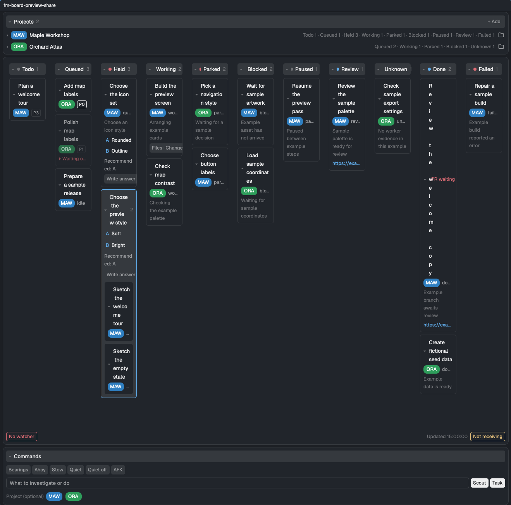

# Firstmate for Herdr

A Herdr window with a task board, read-only Files and Changes viewer, and a tab bar with a Board button.

## What you see

A 268px left sidebar contains the workspace brand, spaces, agents, and footer.

The main area has a 42px tab bar, a flexible active-tab pane, a hidden right panel, and a 28px status bar.
When the panel is shown it takes two thirds of the row and the active-tab pane one third, so both narrow and widen with the window.

The tab bar sits on the chrome background and shows tabs plus Board, Files, and Changes panel buttons.

The board shows project rows above the Kanban section, which holds a search field with a find icon above the task columns, a footer with update and watcher status, and command controls below.
Its surfaces, borders, text, and status dots use the active Herdr theme; project badges use a three-letter abbreviation and a color of its own: a project gets the first palette color no other project holds when it is first seen and keeps it when others are added or removed, and its color is freed once a successful read finds it in neither the registry nor any card, so projects get distinct colors while free palette colors remain.
When none is free, or local storage cannot be used, a project takes a color derived from its name and keeps it even after a color is freed; a project with a chosen color keeps its automatic color reserved for when Auto is chosen again; in those cases two projects can share a color.
Each Board copy's text follows Herdr's terminal font size and grows with that copy's width.

## How it behaves

Tab clicks select a tab, double-clicking its name starts rename, dragging a tab reorders it, and right-clicking opens Herdr's tab menu.

The active tab has a close control, the plus button opens Herdr's new menu, and scrolling the tab rail changes tabs.

The panel buttons select or hide their panel; the chosen panel is remembered per space.

Todo, Queued, Working, Done, and Failed columns always appear.
Held, Parked, Blocked, Paused, Review, and Unknown appear while they contain cards.
The Held column draws its cards in up to three labelled groups, each with its card count and shown only while it holds a card: `Answer now`, then `Deferred`, then `Waiting on other work`.
Each group starts with a heading strip across the column that carries its name and card count.
The fleet snapshot's `hold_bucket` places a card: `live` is answered now, `dated` and `aged` are deferred, and `blocked` waits on other work.
Only captain holds have a bucket: an `external` hold waits on other work, and a captain hold with no bucket is answered now.
A deferred card that has a `hold_until` date shows it on its state row as `until <month>-<day>`, such as `until 12-01`.
Their header dots use the theme's idle, working, blocked, done, unknown, and red colors as appropriate.
Clicking a column header folds it; below 720px wide the columns stack vertically and the board scrolls as one list.
The Kanban search matches task ids and the title, note, and decision text on cards, ignoring case.
Enter or the find icon applies it: each column then shows only matching cards, columns and cards holding a match open even when folded, and the current match gets an accent border.
Pressing Enter or the icon again steps through the matches with an `n/m` count; fold and collapse clicks on Kanban cards and columns do nothing while a search is set.
Esc, or Enter or the icon with an empty field, restores the full board and the remembered folds.

Cards show their project, priority when present, the task's state, and available detail.
Firstmate's validation detail reads as short text such as `Validating: running`, `Waiting for a firstmate decision at review`, or `Checks passed · PR ready for review`, without run ids or the PR link, which the card shows separately, taking it from Firstmate's detail when the worker never reported one; other detail keeps Firstmate's own text without run ids, and shows the worker's last status text only when nothing else is left.
The search still matches Firstmate's original detail text.
Clicking a card header folds it; its question-mark icon puts the task id and full title into the Firstmate chat input without pressing Enter.
Topic-group headers have the same icon for all their task ids and the group question.
Queued cards waiting on other tasks are dimmed, and clicking their waiting row expands the dependency chain.
Held decisions with the same explicit topic share a question and options; in the Held column a topic box is drawn inside each group that holds one of its cards.
A card lists every decision its worker's status log still holds open, from the snapshot's `hints.open_decisions`, oldest first: the decision's verb (`needs-decision` or `blocked`) and key, its text up to 240 characters, and its options when the text has them.
A detail line that would only repeat one of those decisions is left out.
An unobservable worker uses recorded status evidence when available, otherwise it appears in Unknown.
Cards with a finished worker and a review link show a PR waiting badge while the backlog and worker detail still indicate pending review.
The board does not query the forge to check whether the link has merged.

Clicking an option of a held decision puts `[Board answer] <ids>: <label> (<option text>) ` into the Firstmate chat input, ready to edit and confirm with Enter.
The Ask icon inserts `` `[Board card] <ids>: <title or group question>` `` followed by one space for questions about the task; backticks inside the title or group question are inserted as single quotes so they cannot close the code span early.
Clicking an open decision's text puts `[Board answer] <id> [key=<key>]: ` there, and clicking one of its options puts `[Board answer] <id> [key=<key>]: <label> (<option text>) `; the key names that one decision, so Firstmate can close it with `fm-send.sh --resolve-key <key>` even when the card has several.
All these drafts stay on one line with a trailing space, and the input receives focus so you can keep typing.
Held cards without options use the chat input for free-text answers; a hold's options outside the Held column are shown as plain text.
Live cards can open their worker with a terminal icon, and the read-only Files and Changes viewer with a `Files · Changes` button when the snapshot reports the worker's copy of the project as present (`paths.worktree`); the viewer's source picker then offers that copy beside the project's local copy.
When the card's worker terminal is live and still labeled with the card's task, the card ends in a Live strip set apart by a light tint of the theme's working color, so the card body above keeps the shape of cards in other columns.
The strip's header holds a working-color dot, the worker terminal's own status as Herdr reports it (`Worker working`, `Worker blocked`, or `Worker idle`, which also covers a finished turn; `Live` when the terminal reports none), the Open worker icon, and a Peek icon that opens Herdr's peek of that terminal over the current tab without focusing, switching, or typing anything; both icons have tooltips and screen reader labels.
That status describes the worker terminal, not the task, so a card can read `working` while its strip reads `Worker idle`, for example while validation runs in the background after the worker ended its turn.
Below the header, in the terminal font, the strip shows the last one or two lines of the worker's screen that hold text above its input row, the last row starting with a prompt glyph (`›`, `❯`, or `>`, bare or inside a box edge), so a coding agent's input box, status line, and key hints below it are left out; escape codes, blank rows, and rule, box, or spinner-only rows are left out too, and each line is cut to the card width.
A screen with no input row, such as a plain shell, shows its last such lines, and a card whose screen has none shows no lines; the strip keeps room for two lines, so the card's height does not change as lines come and go.
Every 4 seconds the board reads the screen of each such card it last drew (not folded, filtered out, or in a collapsed column), at most once per terminal per round, and a new round waits up to 10 seconds for the previous one to finish; a failed read shows no lines, and hovering the lines tells why until a read of that terminal succeeds.
A read can outlast its 1.5-second timeout when a process it started keeps its output open, so a round still unfinished after 10 seconds is dropped and the next round starts, instead of stopping the lines for good; a terminal whose read is still running is read again only once that read is 10 seconds old, with at most two reads under a minute old running for it, so it is read again within a minute of reads working again, and its lines stay empty, with the age of its oldest unfinished read in the tooltip, until a read of it succeeds.
Herdr tells a mod nothing when its panel is hidden, so these reads continue while the Board panel is hidden, and stop when no drawn card has a live worker.
These lines are only drawn on the card; the board does not log or save them.

A card with a live worker terminal shows `백그라운드 실행 중: <job>` on a tinted row with a working-color dot while that terminal still runs a job after its agent's turn ended, such as a build, a test run, a validation run, or a CI wait.
A Paused card is also drawn in the Working column for as long as the job runs and returns to Paused when it ends; cards in other columns keep their column and only gain the row.
Paused cards also show `Waiting for: <reason>` from the worker's latest `paused` status line, with machine noise stripped, `until <UTC>` shown in local time (with the month and day when it is not today), a PR link shortened to `owner/repo#N`, the row text starting at any waiting, `until`, or resume clause (rotated at the `;` or `, ` before it, or at the `;` when an `until` follows a comma) with the rest after it, and the full cleaned text in its original order in the tooltip, alongside any background-job row when both apply.
A worker that Herdr reports as working gains nothing, because the commands it runs are part of its turn.
The job comes from the processes under the worker's terminal, not from the worker's status text, so a worker that only reported a wait and stopped stays Paused.
Every 5 seconds the board takes one process listing with `/bin/ps` for all such cards, drawn or not, and looks at the processes started under each terminal's own program.
Only known commands count, because an agent keeps helpers such as tool servers running the whole time: `no-mistakes`; `dotnet`, `npm`, `pnpm`, `yarn`, `bun`, `cargo`, `go`, `swift`, and `make` with a subcommand that tests, builds, checks, or installs, such as `test`, `build`, `format`, `typecheck`, or `restore`, and `npm`, `pnpm`, `yarn`, and `bun` running a script, with or without `run`, whose name, or the part of it before the first `:`, is such a subcommand, such as `npm run test`, `npm run test:e2e`, `pnpm run build:prod`, or `pnpm test:e2e`; `pytest`, `jest`, `vitest`, `node --test`, `xcodebuild`, and `tsc`; `gh run watch` and `gh pr checks`, also through `gh-axi`, shown as a CI wait; a script whose file name has `test`, `tests`, `check`, `lint`, `build`, `validate`, or `verify` as a word, shown by its name; and an inline shell command that contains `sleep`, which is a wait loop.
A program started with `run`, such as `dotnet run`, `go run`, `cargo run`, or `npm run dev`, a script with any other name, such as `npm run serve`, `npm run start`, or `npm run watch`, a script with a later `:` part of `watch`, `dev`, `serve`, or `start`, such as `npm run test:watch` or `npm run build:watch`, a dev server, `dotnet watch`, and any command with a `--watch` option (or `tsc -w`) never count, because they keep running after the work is done; `gh pr checks --watch` still counts as a CI wait.
The agent itself, a tool server, and an idle MSBuild or compiler server never count, and neither does a command the board does not know or a job detached from the terminal's process tree.
The row names one job: the one nearest the terminal's program, with a wait loop named only when nothing else runs.
A listing that fails, or is stopped after 3 seconds, clears the row from every card, so no card is shown as running on old evidence.
A round still unfinished after 10 seconds is dropped the same way and the next one starts, with at most two listings under a minute old running at once, so the rows come back within a minute of listings working again.
The command lines are only read to find these jobs; the board does not log or save them.

The Projects list shows up to about 260px of rows and scrolls with the mouse wheel beyond that, so every project is reachable.
Project rows can be expanded to show details, a project filter, color choices that replace the automatic color, a folder button, and a removal request.
The project section can add a repository URL or a selected local repository by sending a request to Firstmate.
Folded sections and cards, collapsed columns, and project colors, automatic and chosen, are remembered locally.
Command buttons submit Bearings, Ahoy, Stow, Quiet, Quiet off, AFK, or Update commands to the verified Firstmate terminal; the Scout and Task fields also submit requests there.
On each insertion or send, the board asks `home/bin/fm-inbox.sh ready` to inspect the session lock and uses its PID only when the lock is held by a live harness.
It matches that PID to a live terminal's foreground PID, checking its ancestry against terminal PIDs only when no foreground match exists.
If the lock cannot be read or no terminal can be proven, commands and Scout or Task requests fall back to the Firstmate inbox, while card drafts only show a notice and file nothing.
The Memo button beside Task never types into the terminal: it always saves the text as a Firstmate inbox note (`fm-inbox.sh note`) that asks Firstmate to file it in the backlog without starting work, so it is written to disk at once whether Firstmate is running, stopped on a usage limit, or closed, and it shows in the Projects list as a pending request.
A failed save keeps the text in the field.

The tab bar marks working tabs with a spinner, blocked and done tabs with status dots, and zoomed tabs with a `Z` suffix.
Idle tabs have no activity marker.
Controls highlight on hover, and project badges and several buttons have explanatory tooltips.
The board watches the home's state and data folders and has a 30-second refresh fallback; its footer update time is displayed in Korea time.

## Built from

`layouts/firstmate.json` is a row with a 268px sidebar and a flexible work column. The work column contains the 42px `fm-tabs` block, a row with an active-tab block (weight 1, at least 480px) and a hidden panel stack (weight 2, at least 280px), and a 28px `workspace-status` block.

The panel stack contains Herdr's shipped `files` and `changes` mods and the `fm-board` mod. Its `home` prop is the path to the Firstmate home; set it before using the layout.

`fm-tabs` is based on Herdr's shipped `tabs` mod. It uses `spaces`, `panes`, `layout`, `shared`, `theme`, `window`, and `settings`, and runs `tab.select`, `tab.rename`, `tab.move`, `tab.close`, `tab.prev`, `tab.next`, `layout.select`, `layout.show`, and `layout.hide`. It opens Herdr's `menu` and `new-menu` overlays and uses its own `board.svg` icon.

`fm-board` uses `props`, `theme`, `settings`, `exec`, `readTextFile`, `watchFolder`, `pickFolder`, `run`, `focused`, and `terminals` from `herdr`.
It draws Herdr's shipped `files` folder icon and `workspace-chrome` search, terminal, and layers icons.
It reads a fleet snapshot and project registry, invokes Firstmate's `fm-fleet-snapshot.sh` and `fm-inbox.sh` under `home/bin`, and calls `hc` to inspect or message terminals and `hc read` to read live worker screens for the card lines.
Its Peek icon runs Herdr's `terminal.peek` command.
Card drafts use macOS `pbpaste` and `pbcopy` to save clipboard text to a temporary file and restore it around Herdr's `terminal.paste` action; they verify terminal focus before pasting and leave Enter to the owner.
They first read the clipboard types with `osascript`; plain text is restored as is, and rich text such as HTML, RTF, or a web archive is restored as plain text with its formatting dropped.
If the clipboard holds an image, files, or RTFD, which can carry attachments, or holds no plain text at all, nothing is inserted, the clipboard is left untouched, and a notice asks you to paste it first.
It uses `agent.focus` to focus Firstmate or show a matching worker, `ps` to check supervision processes and the session lock holder's parent processes, `/bin/ps` to list processes for the cards' background job rows, and `open` for folders or review URLs.
Its `viewer.js` reads selected project or worker folders, lists files through `sh`, and runs read-only Git status and diff commands with optional locks disabled.
The viewer has Files and Changes tabs, read-only syntax-highlighted file contents, diff lines, a source picker for local or worker copies, and a draggable divider beside the board.
Optional `snapshot_file`, `collapsed`, and `ui` props supply saved board data and initial UI state for previews.

## Watch out

The board is trusted code: it runs `hc`, Firstmate scripts, Git, and other local programs through Herdr, and it reads the configured Firstmate home outside its own mod folder.
It reads the screens of live worker terminals every 4 seconds, so whatever a worker prints can appear on its card.
While a card has a live worker it also lists every process on the machine with its command line every 5 seconds, and the file name of a script a worker runs can appear on its card.
Its request controls communicate with the Firstmate session and can ask it to make changes.

The layout ships with an empty `home` prop.
Fill it with the absolute Firstmate installation and home path or the board shows a setup card.
The home must contain the matching `bin`, `data`, `state`, and `projects` folders and produce `fm-fleet-snapshot.v1` snapshots.
This build assumes Unix tools such as `sh`, `ps`, Git, and `/usr/bin/env`; opening folders and URLs uses macOS's `open` command.

The panel is sized as a share of the row, not in pixels, because Herdr never shrinks a node sized in pixels: in a narrow window such a panel keeps its width, takes the active-tab pane's room, and runs past the window's right edge.
The active-tab pane keeps at least 480px and the panel at least 280px; with the sidebar open, a window narrower than about 1,053px leaves the panel running past the right edge.
`layout.resize` with `weight` on `panel` changes the share and keeps it flexible; with `px` it pins a pixel width, and then only the pane's 480px minimum still holds in a narrow window.
Whether dragging the divider saves a share or a pixel width has not been tested.
With all 11 columns open at about 1,320px pane width, card titles wrap heavily.
A Done card's PR waiting badge can overlap its title and leave the title wrapping one letter per line.
Collapse some columns or give the board more width when this happens.
The preview shows a search for one fictional project's tasks and the temporary capture mod's name in the pane header.
The board shows at most 20 Done cards.
The viewer bounds listings to 500 entries per folder and 5,000 total, changes to 1,000 files, and diffs to 1,500 lines.
The Files and Changes viewer does not edit, commit, stage, or discard files.

The layout and mods expect Herdr's shipped `workspace-chrome`, `spaces`, `agents`, `workspace-status`, `pane`, `files`, `changes`, `menu`, and `new-menu` mods.

## Done when

Both mod folders pass `herdr-app check`.

`node --test tests/` passes: it draws the board outside Herdr from `tests/fixtures/snapshot.json`, a fictional snapshot in the shape `fm-fleet-snapshot.sh` prints, and checks the `Files · Changes` button, the Held groups, and the open decisions with their answer drafts.

The layout opens with the configured Firstmate home, displays the board and panel controls, and switching spaces restores each space's selected panel.

The board loads projects and cards, its Kanban search narrows the columns to matching cards and steps through them, and its file viewer shows read-only file and Git change information for a selected project.

With `home` missing or blank, a clear Firstmate home required card appears without reading home files or running helper programs.
